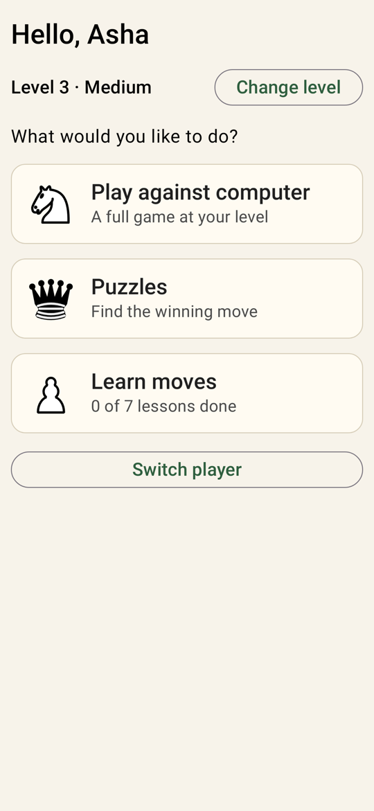
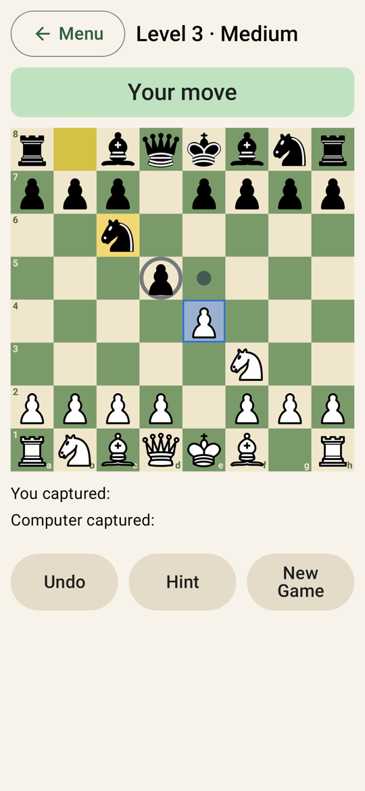
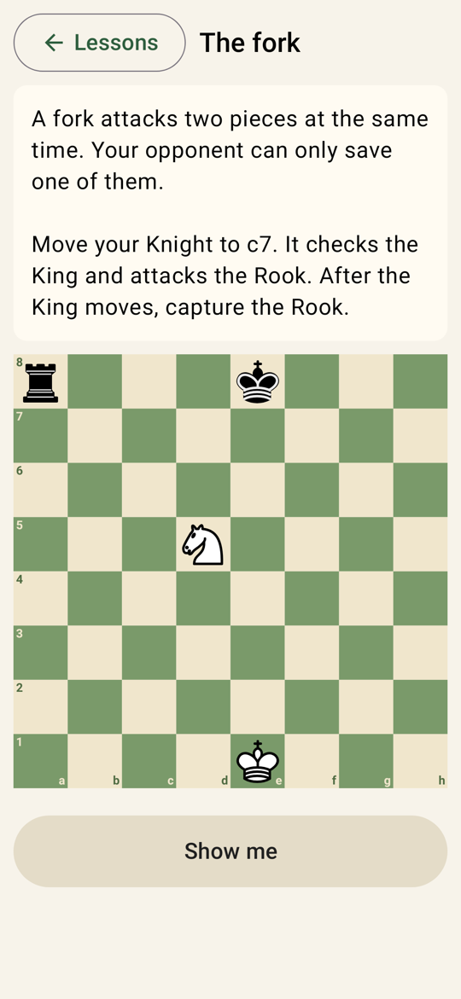

# Our Chess

A calm, simple chess app for Android phones and tablets, made for the whole family, especially older players.
Play against the computer at five difficulty levels, solve puzzles, and learn useful moves with hands-on lessons.

<p>
  
  
  
</p>

## Features

- **Easy on the eyes**: large, bold, high-contrast pieces on a soft, low-glare board; large text and buttons with words, not just icons.
- **Simple to play**: tap a piece, then tap where it should go (dragging works too). Legal moves are shown as dots, and the computer's last move stays highlighted.
- **Player profiles**: each family member enters just their name. Their level, puzzle progress, finished lessons and game in progress are remembered.
- **Family photos**: the app opens with three random family pictures, and every player can add their own (kept privately on the device).
- **Five difficulty levels**, from *Beginner* to *Expert*, powered by [Stockfish](https://stockfishchess.org) and scaled to the player.
- **Puzzles**: 600 hand-picked puzzles (120 per level) from the [Lichess puzzle database](https://database.lichess.org/#puzzles), with hints and solutions.
- **Learn moves**: interactive lessons on castling, promotion, en passant, forks, pins, skewers and back-rank mate.
- **Forgiving**: unlimited undo, a hint button, no clock, optional "ask before each move", and games are saved automatically.
- **Settings for each player**: board colours (including high contrast), large-print letters on pieces, move sounds, vibration, and moves read aloud.
- **Magnifying glass**: zoom the whole app in or out with one tap; each player's size is remembered.
- **Accessible**: works with large system text (up to 200%) and with TalkBack; board coordinates sit outside the squares.
- **Works on phones and tablets**, in portrait and landscape.

## Install

Download the latest `OurChess-vX.Y.Z.apk` from the **[Releases](../../releases)** page and open it on your Android device
(Android 8.0 or newer, 64-bit ARM). You may need to allow "Install unknown apps" for your browser or file manager.
Step-by-step instructions for family members: **[docs/install-guide.md](docs/install-guide.md)**.

> Release APKs built on GitHub show a plain loading screen. The family edition with private photos is built
> locally; see [docs/releasing.md](docs/releasing.md).

## Building

The project is developed entirely in **VS Code** with the Android command-line tools. No Android Studio is needed.

```bash
./gradlew assembleDebug        # build (downloads and verifies Stockfish on first run)
./gradlew testDebugUnitTest    # run all tests
./gradlew installDebug         # install on a connected device
```

In VS Code, use **Terminal → Run Task** for one-click build, run-on-device, tests, screenshots and releases.
Full setup instructions: **[docs/development.md](docs/development.md)**.

## Documentation

| Document | What's in it |
|---|---|
| [docs/install-guide.md](docs/install-guide.md) | How family members install and update the app |
| [docs/requirements.md](docs/requirements.md) | What the app must do and why, and who it is for |
| [docs/architecture.md](docs/architecture.md) | How the code is organised and how the pieces fit together |
| [docs/development.md](docs/development.md) | Setting up a computer, building, testing, running on a device |
| [docs/releasing.md](docs/releasing.md) | Versioning, release tags, signing keys, the family edition |
| [docs/decisions.md](docs/decisions.md) | Key technical decisions and the reasons behind them |
| [docs/roadmap.md](docs/roadmap.md) | What has been built, phase by phase, and ideas for later |

## Credits and licence

Our Chess is free software, licensed under the **GNU General Public License v3.0** ([LICENSE](LICENSE)),
because it bundles Stockfish.

- **Chess engine**: [Stockfish](https://github.com/official-stockfish/Stockfish) 19, GPL-3.0
- **Chess rules**: [chesslib](https://github.com/bhlangonijr/chesslib), Apache-2.0
- **Pieces**: "cburnett" set by Colin M.L. Burnett, GPLv2+ / CC BY-SA 3.0 (outlines thickened for readability)
- **Puzzles**: [Lichess puzzle database](https://database.lichess.org/#puzzles), CC0
