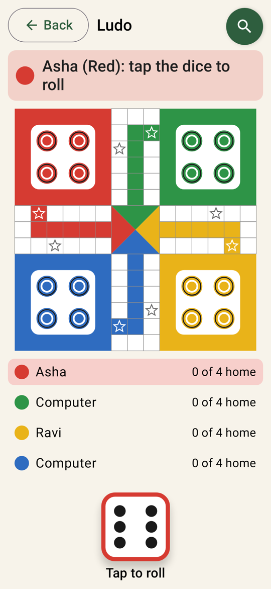

# Our Board Games

A calm, simple collection of board games for Android phones and tablets, made for the whole family, especially older players:
**Chess**, **Checkers** and **Ludo**. Play against the computer at five difficulty levels, play Ludo together with family
on one device, solve puzzles, and learn with hands-on lessons.

<p>
  
  
  
</p>

## Features

- **Three games**:
  - **Chess** against [Stockfish](https://stockfishchess.org), with 600 puzzles and 7 lessons.
  - **Checkers** (Russian rules: flying kings, men capture backwards, compulsory captures) against a built-in engine, with puzzles and 7 lessons.
  - **Ludo** for 2–4 players: any mix of family members (passing the device) and computer players, with a hands-on tutorial.
- **Easy on the eyes**: large, bold, high-contrast pieces on a soft, low-glare board; large text and buttons with words, not just icons.
- **Simple to play**: tap a piece, then tap where it should go. Possible moves are shown, and the computer's last move stays highlighted.
- **Player profiles**: each family member enters just their name. Their level, progress, settings, saved games and statistics are remembered.
- **My statistics**: games won, drawn and lost, per game and level.
- **Family photos**: the app opens with three random family pictures, and every player can add their own (kept privately on the device).
- **Five difficulty levels**, from *Beginner* to *Expert*, for every game.
- **Forgiving**: undo, hints, no clock, optional "ask before each move", and games are saved automatically.
- **Settings for each player**: board colours (including high contrast), large-print letters on pieces, move sounds, vibration, and moves read aloud.
- **Magnifying glass**: zoom the whole app in or out with one tap; each player's size is remembered.
- **Accessible**: works with large system text (up to 200%) and with TalkBack.
- **Works on phones and tablets**, in portrait and landscape.

## Install

Download the latest `OurBoardGames-vX.Y.Z.apk` from the **[Releases](../../releases)** page and open it on your Android device
(Android 8.0 or newer, 64-bit ARM). You may need to allow "Install unknown apps" for your browser or file manager.
Step-by-step instructions for family members: **[docs/install-guide.md](docs/install-guide.md)**.

> Release APKs built on GitHub show a plain loading screen. The family edition with private photos is built
> locally; see [docs/releasing.md](docs/releasing.md).

## Building

The project is developed entirely in **VS Code** with the Android command-line tools. No Android Studio is needed.

```bash
./gradlew assembleDebug        # build (downloads and verifies Stockfish on first run)
./gradlew testDebugUnitTest    # run all tests
./gradlew installDebug         # install on a connected device
```

In VS Code, use **Terminal → Run Task** for one-click build, run-on-device, tests, screenshots and releases.
Full setup instructions: **[docs/development.md](docs/development.md)**.

## Documentation

| Document | What's in it |
|---|---|
| [docs/install-guide.md](docs/install-guide.md) | How family members install and update the app |
| [docs/requirements.md](docs/requirements.md) | What the app must do and why, and who it is for |
| [docs/architecture.md](docs/architecture.md) | How the code is organised and how the pieces fit together |
| [docs/development.md](docs/development.md) | Setting up a computer, building, testing, running on a device |
| [docs/releasing.md](docs/releasing.md) | Versioning, release tags, signing keys, the family edition |
| [docs/decisions.md](docs/decisions.md) | Key technical decisions and the reasons behind them |
| [docs/roadmap.md](docs/roadmap.md) | What has been built, phase by phase, and ideas for later |

## Credits and licence

Our Board Games is free software, licensed under the **GNU General Public License v3.0** ([LICENSE](LICENSE)),
because it bundles Stockfish.

- **Chess engine**: [Stockfish](https://github.com/official-stockfish/Stockfish) 19, GPL-3.0
- **Chess rules**: [chesslib](https://github.com/bhlangonijr/chesslib), Apache-2.0
- **Pieces**: "cburnett" set by Colin M.L. Burnett, GPLv2+ / CC BY-SA 3.0 (outlines thickened for readability)
- **Checkers and Ludo engines**: written for this app
- **Chess puzzles**: [Lichess puzzle database](https://database.lichess.org/#puzzles), CC0
