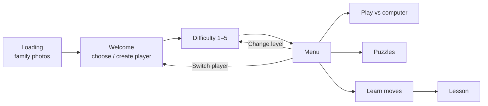

# Architecture

Our Chess is a single-module Android app written in **Kotlin** with **Jetpack Compose**. It has no server and no
network use at runtime: everything, including the chess engine, runs on the device.

## Screen flow



Navigation is a simple back stack of `Screen` values held in `AppViewModel`. The Android back button pops it.

## Source layout

```
app/src/main/java/com/sumesh/ourchess/
├── MainActivity.kt          Starts the engine provider and shows App()
├── game/                    Chess rules — no Android dependencies
│   ├── Model.kt             Side, PieceType, Piece, Square, Move, GameStatus
│   └── ChessGame.kt         One game: legal moves, make/undo, status, captures (wraps chesslib)
├── engine/                  The computer opponent
│   ├── ChessEngine.kt       Interface: FEN in → UCI move out
│   ├── UciProcess.kt        Runs the Stockfish executable and talks UCI to it
│   ├── StockfishEngine.kt   Stockfish at a given strength (+ occasional random moves at low levels)
│   ├── Engines.kt           Level → strength table; provides engines (falls back if Stockfish can't run)
│   └── RandomMoveEngine.kt  Fallback opponent
├── data/                    Saved on the device (JSON files in app-private storage)
│   ├── Profile.kt           Player profile + level names/descriptions
│   ├── ProfileRepository.kt profiles.json
│   └── SavedGameStore.kt    games/<player>-L<level>.json — the game in progress
├── puzzles/Puzzle.kt        Loads assets/puzzles.csv
├── tutorials/Lessons.kt     The lesson content (positions, instructions, solutions)
└── ui/
    ├── App.kt, AppViewModel.kt   Navigation, current player, app-wide state
    ├── board/               ChessBoard composable (drawing, tap/drag, animation), piece images
    ├── common/              Shared building blocks: buttons, cards, headers, BoardScreenLayout, dialogs
    ├── exercise/            ExerciseSession: "find the right moves" logic shared by puzzles and lessons
    ├── game/                Game screen + GameViewModel (play, undo, hint, save, game over)
    ├── loading/, welcome/, level/, menu/, puzzles/, tutorials/   One package per screen
    └── theme/               Colours and typography (larger than Material defaults)
```

## Key design points

### Rules vs. presentation
`game/` knows nothing about Android or Compose and is fully unit-tested. Everything above it talks in the app's own
types (`Square`, `Move`), so chesslib could be replaced without touching the UI.

### State
Screens are driven by immutable UI-state objects (`GameUiState`, `ExerciseUiState`) published from view models via
Compose `mutableStateOf`. Each user action calls a view-model function, which updates the game and publishes a new
state. View models are keyed per player and level (`viewModel(key = …)`) so leaving a screen and coming back resumes
where the player left off.

### The board
`ChessBoard` draws squares, highlights and coordinates on a single `Canvas`, and places piece images on top. Moves
slide with an `Animatable`, keyed by a `MoveAnimation.id` so that only new moves animate (not undo). Tap and drag
gestures are both supported; the dragged piece is enlarged and lifted above the finger.

### Exercises (puzzles and lessons)
`ExerciseSession` holds a position and a list of solution moves (player, reply, player, …). It checks each player
move, plays the opponent's replies with a delay, takes back wrong moves, offers hints, and can play out the
solution. On the final move, any checkmate is accepted, since some puzzles have more than one mating move.

### The engine
Stockfish is an executable, not a library. It is packaged as `lib/arm64-v8a/libstockfish.so` so that Android
installs it into the app's native-library directory, the one place an app may execute files from. `UciProcess`
starts it on first use (warmed up during the loading screen), and serialises searches with a mutex. A cancelled
search (e.g. Undo while the computer is thinking) is allowed to finish in the background so the engine stays in a
clean state.

Strength per level (`EngineLevels` in `Engines.kt`):

| Level | Stockfish Skill | Search | Random-move chance |
|---|---|---|---|
| 1 Beginner | 0 | depth 1 | 25% |
| 2 Easy | 3 | depth 2 | 8% |
| 3 Medium | 7 | depth 5 | — |
| 4 Hard | 12 | depth 9 | — |
| 5 Expert | 17 | 0.7 s | — |
| Hints | 20 | 0.6 s | — |

The computer always "thinks" for at least 0.7 s so its replies never feel abrupt.

### Storage
Small JSON files in app-private storage, written atomically (write to a temp file, then rename):
`profiles.json` and `games/<profile-id>-L<level>.json`. Nothing leaves the device.

### Build-time assets
- **Stockfish** is downloaded from the official GitHub release by Gradle (`downloadStockfishAndroid`), checked
  against a pinned SHA-256, and extracted into `build/generated/stockfish/jniLibs`.
- **Family photos** in `app/images/` (git-ignored) are copied into the APK's `assets/loading/` by the
  `familyPhotos` task when present.
- **Puzzles** (`assets/puzzles.csv`) were selected once from the Lichess database: popular, well-rated puzzles in
  five rating bands (400–900, 900–1200, 1200–1500, 1500–1800, 1800–2100).

## Testing

| Test | What it checks |
|---|---|
| `ChessGameTest` | Rules: checkmate, stalemate, castling, en passant, promotion, undo, draw rules |
| `ContentTest` | Every lesson and all 600 puzzles play out with legal moves (and mates really are mate) |
| `ExerciseSessionTest` | Correct/wrong moves, replies, hints, show-solution, alternative mates |
| `GameViewModelTest` | Save/resume, game-over dialog, play again, material balance |
| `ProfileRepositoryTest`, `SavedGameStoreTest` | Saving and reloading player data |
| `StockfishEngineTest` | Real Stockfish (desktop build): legal moves at every level, hints find mate, cancellation, level 4 beats level 1 |
| `ScreenshotTest` | Renders every screen at phone and tablet sizes (Robolectric + Roborazzi) |
